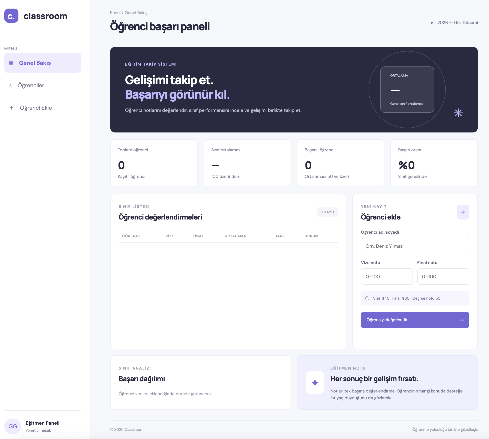

# 🎓 Classroom – Öğrenci Not ve Başarı Takip Sistemi

Bu proje, JavaScript'in temel ve orta seviye konularını pekiştirmek amacıyla hazırlanmış bir hata ayıklama ve problem çözme çalışmasıdır.

Bir öğrenci not takip sistemi üzerinde çalışarak JavaScript kodlarını okuyacak, hataları tespit edecek, nedenlerini anlayacak ve çözümlerini uygulayacaksın.

## 🖥️ Proje Önizlemesi

<!-- Görsel 1: Ana ekran görüntüsü -->


<!-- Görsel 2: Öğrenci ekleme veya not takip ekranı -->


## 🎯 Projenin Amacı

Bu çalışmada yalnızca çalışan bir uygulama ortaya çıkarman değil, yazdığın kodun arkasındaki mantığı anlaman bekleniyor.

Proje boyunca:

- Koşul yapılarını kullanarak karar mekanizmaları oluşturacaksın.
- Döngülerle verileri işleyeceksin.
- Fonksiyonlar yazarak tekrar kullanılabilir kodlar geliştireceksin.
- Algoritma kurma ve problem çözme becerini geliştireceksin.
- JavaScript hatalarını tespit edip düzelteceksin.
- Kodlarını test ederek farklı senaryolarda doğru çalıştığından emin olacaksın.

## 📚 Öğrenilecek Konular

### Faz 3 – Koşullar, Döngüler ve Algoritmalar

- `if`, `else`, `else if`
- Nested If ve `switch`
- Ternary Operator ve Guard Clause
- `for`, `while`, `do...while`
- `for...of` ve `for...in`
- `break` ve `continue`
- Algoritma ve pseudocode
- Edge Case ve hata ayıklama
- Chrome DevTools ve Breakpoint

### Faz 4 – Fonksiyonlar ve İleri JavaScript Mantığı

- Function Declaration ve Function Expression
- Parameters, Arguments ve Return
- Default Parameters
- Arrow Functions
- Rest Parameters ve Callback
- Scope, Hoisting ve TDZ
- Shadowing ve Pure Functions
- Higher-Order Functions
- Closure ve Recursion
- `this` kullanımı

## 🛠️ Kullanılan Teknolojiler

- HTML5
- CSS3
- JavaScript (Vanilla JS)

## 📂 Proje Yapısı

```text
classroom/
│
├── index.html
│
├── css/
│   └── style.css
│
├── js/
│   └── app.js
│
├── assets/
│   ├── classroom-dashboard.png
│   └── classroom-students.png
│
├── GOREV.md
├── GOREV-KOD-OKUMA.md
└── README.md
```

## 🚀 Projeyi Çalıştırma

1. Projeyi bilgisayarına indir veya GitHub üzerinden klonla.
2. Klasörü VS Code ile aç.
3. Dosya yapısını incele.
4. `index.html` dosyasını tarayıcıda aç.
5. JavaScript dosyasını inceleyerek çalışmaya başla.

İstersen VS Code üzerinde Live Server eklentisini kullanabilirsin.

## 📝 Görev ve Çalışma Kuralları

Projeye başlamadan önce aşağıdaki dosyaları mutlaka incele:

- **GOREV.md:** Projede yapman gereken işlemler ve görev adımları.
- **GOREV-KOD-OKUMA.md:** Kodları analiz etmeni sağlayacak sorular ve inceleme çalışmaları.

### Dikkat Etmen Gerekenler

- Kodları doğrudan kopyalama.
- Hazır çözüm kullanma.
- Hataları kendin tespit etmeye çalış.
- Her hatanın neden oluştuğunu anlamadan düzeltme yapma.
- Kodlarını farklı senaryolarla test et.
- Anlamadığın noktaları araştır ve not al.

## ✅ Tamamlandığında Kazanımların

Bu proje sonunda:

- JavaScript koşul ve döngülerini etkin şekilde kullanabileceksin.
- Fonksiyonlar ile modüler kod yazabileceksin.
- Algoritmik düşünme becerini geliştireceksin.
- Mevcut bir projeyi okuyup analiz edebileceksin.
- Debugging araçlarını kullanabileceksin.
- Gerçek bir uygulama üzerinde hata tespiti ve çözümü yapabileceksin.

---

**Unutma:** Yazılım geliştirmek yalnızca kod yazmak değildir. Yazdığın kodu okuyabilmek, hatanın kaynağını bulabilmek ve çözüm üretebilmek de yazılım geliştirmenin önemli bir parçasıdır.

Kolay gelsin! 🚀
